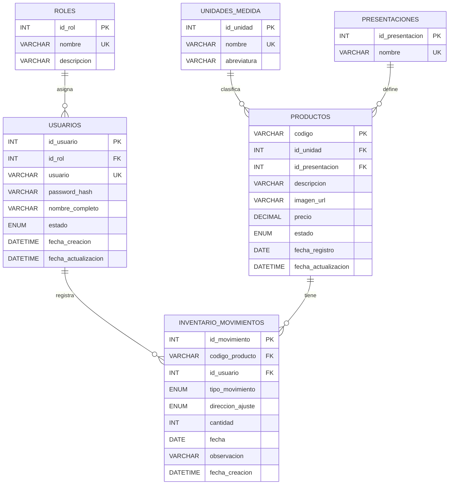

# Diagrama Entidad-Relacion - dbProyecto



## Lectura de las relaciones

- Un rol puede estar asignado a muchos usuarios, pero cada usuario tiene un solo rol.
- Una unidad de medida puede usarse en muchos productos, pero cada producto tiene una sola unidad de medida.
- Una presentacion puede usarse en muchos productos, pero cada producto tiene una sola presentacion.
- Un usuario puede registrar muchos movimientos de inventario, pero cada movimiento lo registra un solo usuario.
- Un producto puede tener muchos movimientos de inventario, pero cada movimiento pertenece a un solo producto.

## Flujo principal

```text
Rol -> Usuario -> Movimiento de inventario <- Producto
                              ^
                              |
                 Unidad de medida + Presentacion
```

Los movimientos `ENTRADA` aumentan existencia (por ejemplo, un reabastecimiento) y los movimientos `SALIDA` la disminuyen (por ejemplo, una venta). Un `AJUSTE` siempre indica su dirección: `SUMA` o `RESTA`. La cantidad actual de un producto se obtiene sumando entradas y ajustes `SUMA`, y restando salidas y ajustes `RESTA`.
